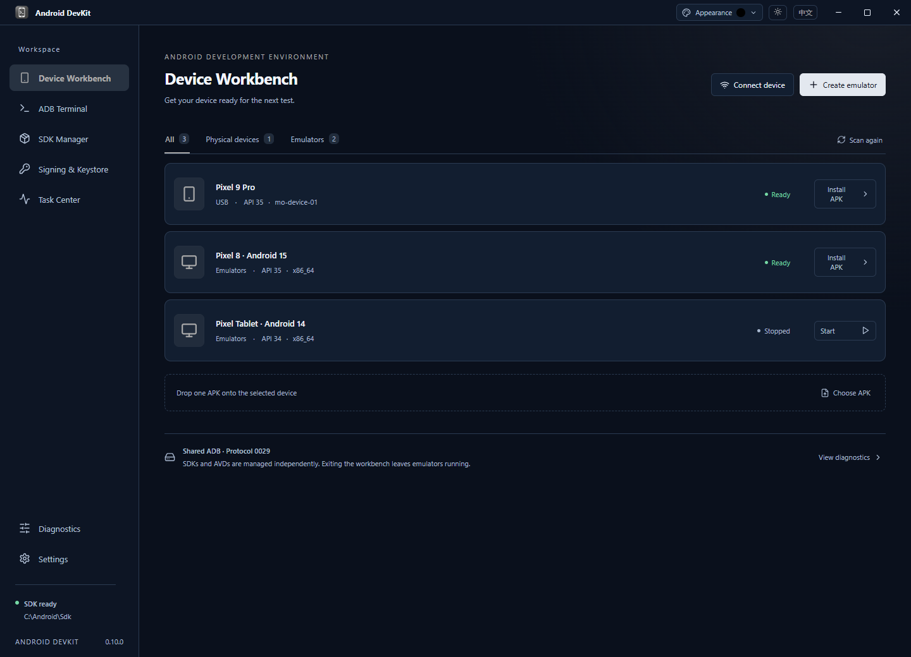
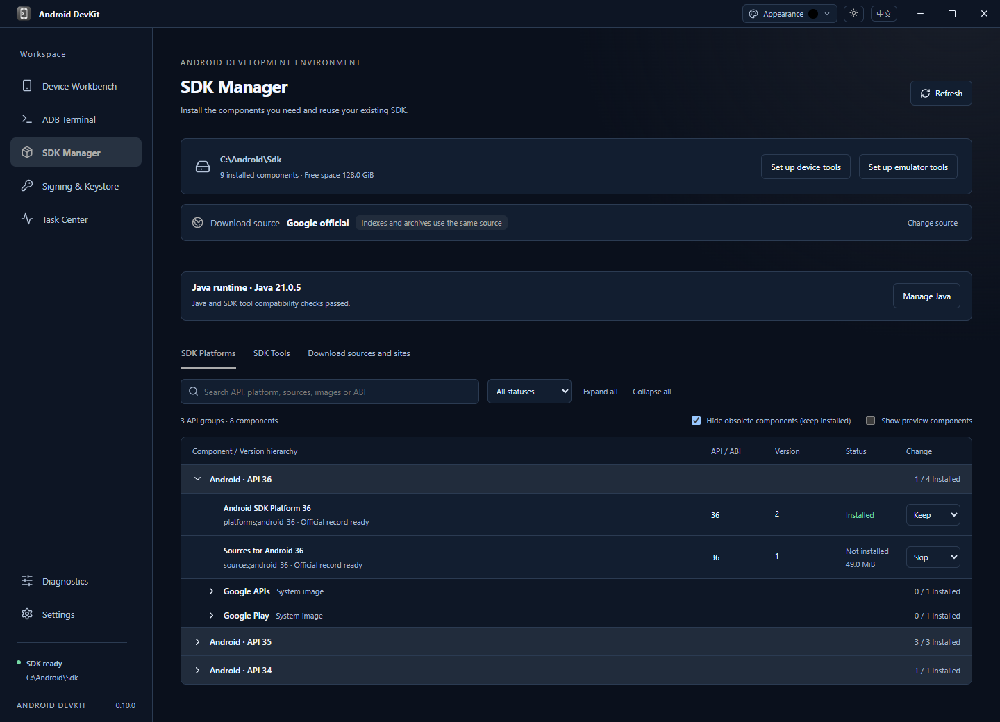
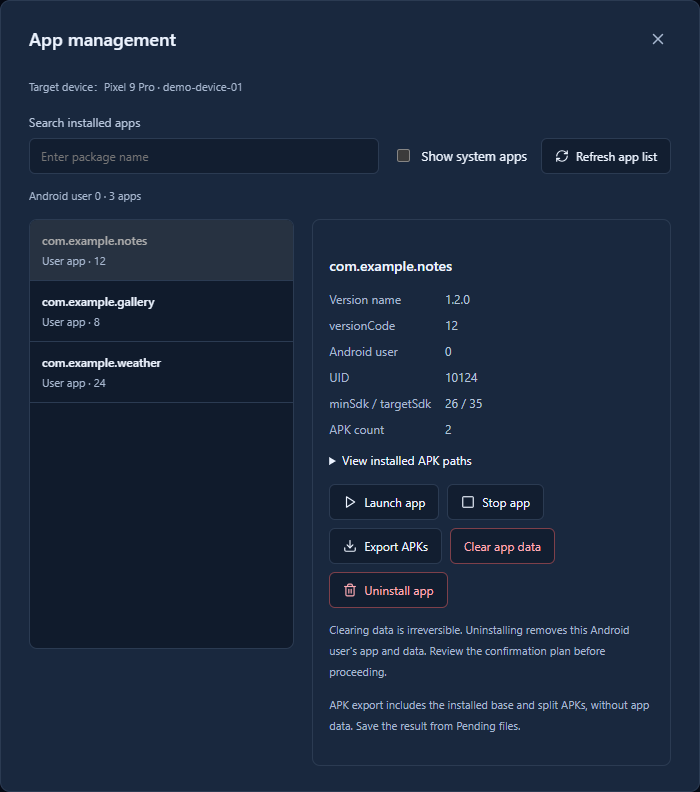
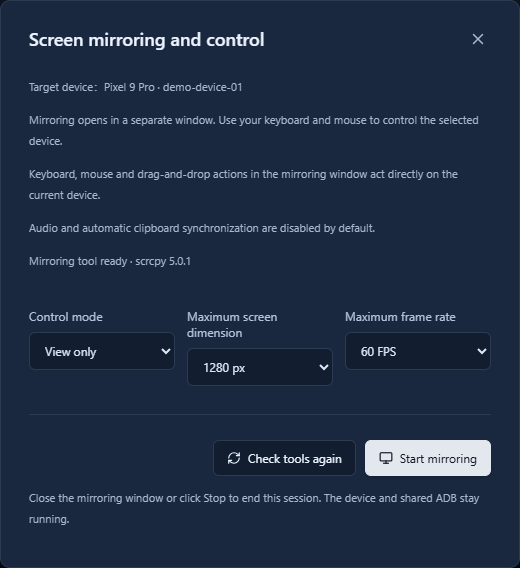
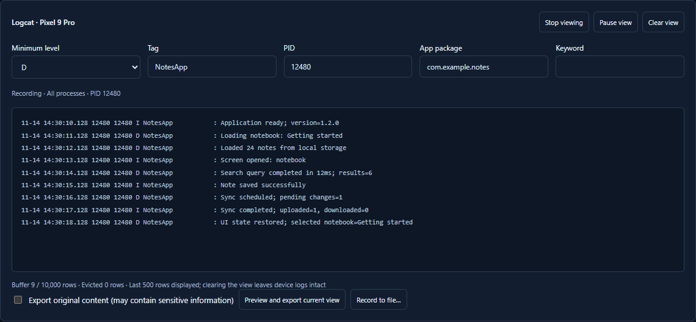
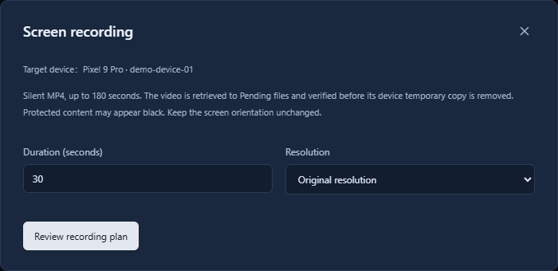
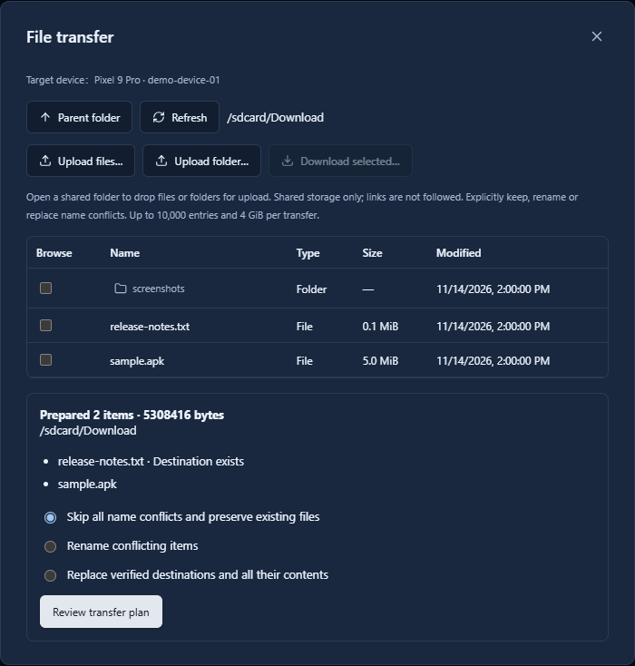

# Android DevKit

[简体中文](README.md) | English

Android DevKit is an Android development workbench for Windows 11 x64. It brings SDK management, emulators, physical devices, app installation, and debugging tools into one desktop app, with support for existing Android SDKs and AVDs.

[Download the latest release](https://github.com/whoarei/android-devkit/releases/latest)

## Features

- **SDK management**: Discover and reuse existing environments, install platforms, tools, and system images, switch download sources, and configure Java.
- **Devices and emulators**: Create, configure, and start emulators; connect physical devices over USB, wireless QR pairing, pairing codes, or network ADB.
- **APK installation**: Drag and drop an APK, install split APK sets, or import APKS / XAPK / APKM archives with target device and compatibility checks.
- **App management**: Inspect app details, launch or stop apps, clear data, uninstall apps, and export complete APK sets.
- **Signing and Keystores**: Create or register JKS / PKCS12 files, inspect certificates and fingerprints, verify, compare, and sign APKs, and copy Keystore Base64 after password verification.
- **Screen mirroring and control**: Mirror devices in a separate scrcpy window, with keyboard and mouse control, read-only mode, resolution settings, and frame rate options.
- **Logs and capture**: Filter live Logcat, collect logs, take screenshots, and record the screen, then preview and export troubleshooting materials.
- **File transfer**: Browse shared device storage, upload or download files and folders, resolve name conflicts, and recover interrupted replacements.
- **Interactive terminals and Task Center**: Open ADB Shell or local PowerShell sessions, manage multiple sessions and background tasks, review history, and save pending files.
- **Personalization and desktop integration**: Switch between Chinese and English, customize theme colors, choose light, dark, or system mode, save preferences, work from the system tray, and check for updates in the app.

## Screenshots

Screenshots show the current interface with demonstration data.

### Device workbench

View physical devices and emulators in one place, connect devices, start emulators, and select an APK installation target.

### SDK management

Review installed components and prepare platforms, development tools, and system images as needed.

### App management

Inspect app versions, system requirements, and APK details, then launch, stop, export, or uninstall apps.

### Screen mirroring and control

Choose keyboard and mouse control or read-only mode, then configure the screen size and frame rate before opening a separate mirroring window.

### Live logs

Filter Logcat by level, tag, PID, package name, and keywords, then preview and export logs.

### Screen recording

Set the recording duration and resolution, then retrieve the completed video, preview it, and save it as MP4.

### File transfer

Browse shared folders, upload and download files, and choose how to handle name conflicts before transferring.

