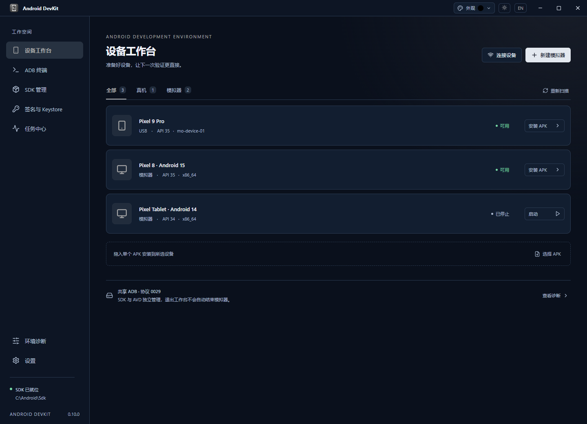
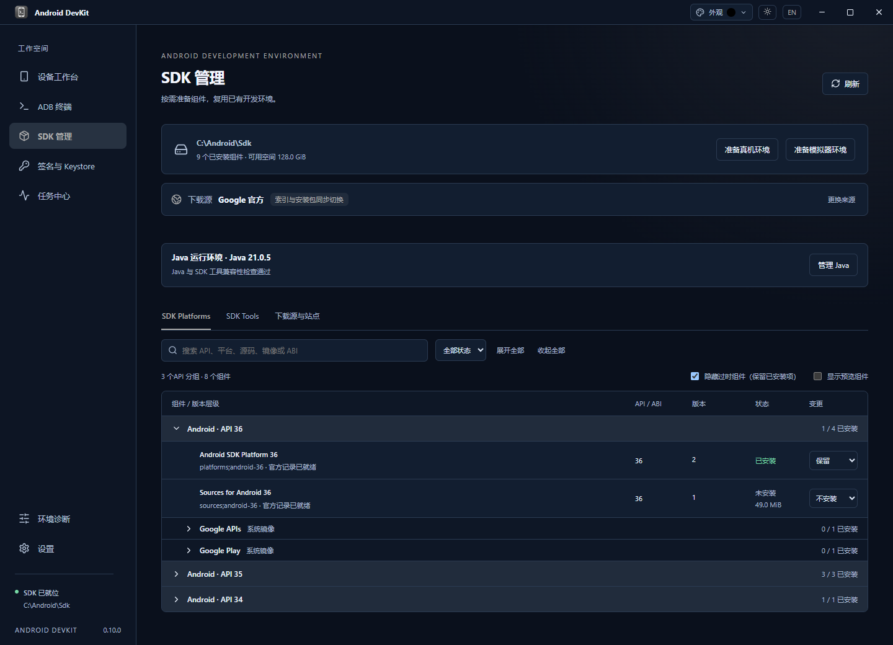
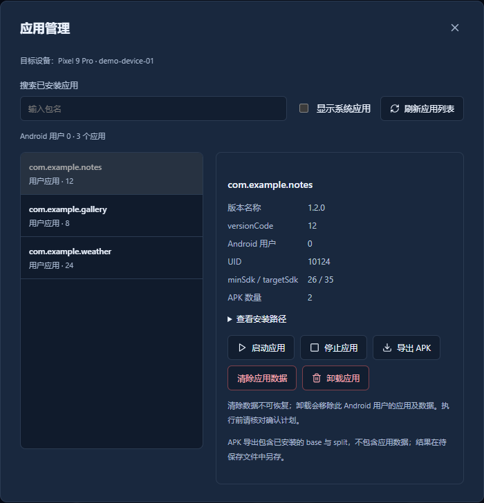
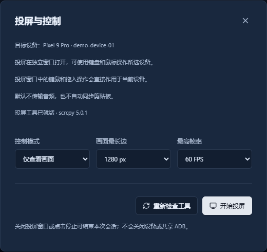
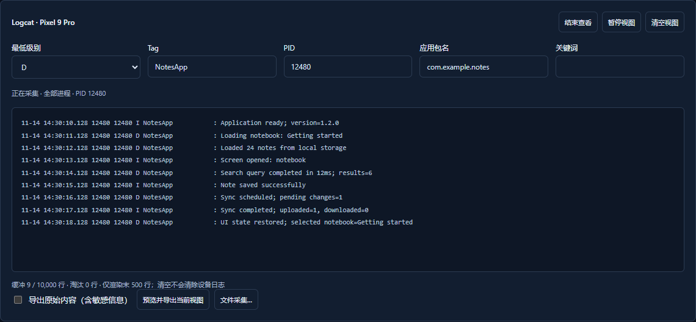
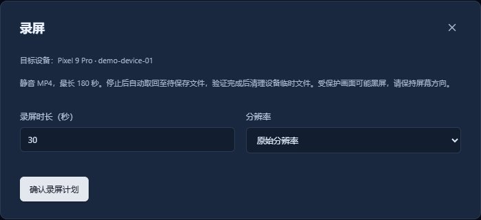
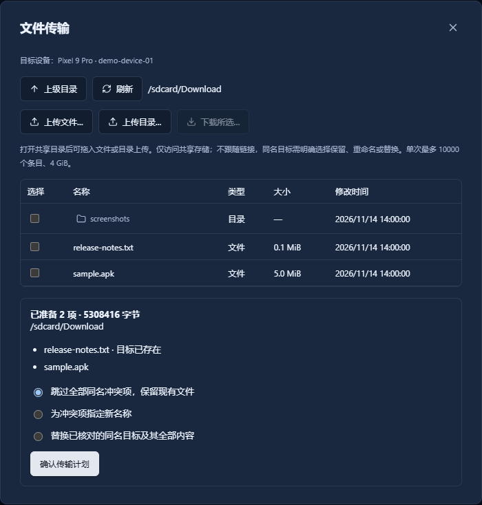

# Android DevKit

简体中文 | [English](README.en.md)

Android DevKit 是面向 Windows 11 x64 的 Android 开发工作台，将 SDK、模拟器、真机、应用安装与调试工具集中在一个桌面应用中，可复用已有 Android SDK 和 AVD。

[下载最新版](https://github.com/whoarei/android-devkit/releases/latest)

## 软件特性

- **SDK 管理**：发现并复用已有环境，按需安装平台、工具与系统镜像，支持下载源切换和 Java 环境配置。
- **设备与模拟器**：创建、配置和启动模拟器，通过 USB、无线扫码、配对码或网络 ADB 连接真机。
- **APK 安装**：拖入安装单个 APK，批量安装分包，导入 APKS / XAPK / APKM，并校验目标设备与兼容性。
- **应用管理**：查看应用信息，启动、停止、清除数据、卸载应用，导出完整 APK 集合。
- **签名与 Keystore**：新建或登记 JKS / PKCS12，查看证书与指纹，校验、比较和签署 APK，验证密码后复制 Keystore Base64。
- **投屏与控制**：使用 scrcpy 在独立窗口投屏，支持键鼠控制、只读模式、分辨率与帧率设置。
- **日志与画面采集**：过滤实时 Logcat、采集日志、截图和录屏，预览后导出排查资料。
- **文件传输**：浏览设备共享存储，上传或下载文件与目录，处理同名冲突并恢复中断的替换操作。
- **交互终端与任务中心**：打开 ADB Shell 或本机 PowerShell，管理多会话、后台任务、历史记录与待保存文件。
- **个性化与桌面体验**：中英文切换，自定义主题色，浅色 / 深色 / 跟随系统，保存使用偏好，支持托盘后台运行和应用内更新。

## 主要功能截图

截图展示当前版本界面，使用演示数据。

### 设备工作台

统一查看真机与模拟器，连接设备、启动模拟器，并选择目标安装 APK。

### SDK 管理

查看已安装组件，按需准备平台、开发工具与系统镜像。

### 应用管理

查看已安装应用的版本、系统要求和 APK 信息，启动、停止、导出或卸载应用。

### 投屏与控制

选择键鼠控制或只读模式，设置画面大小与帧率后打开独立投屏窗口。

### 实时日志

按级别、Tag、PID、应用包名和关键词筛选 Logcat，预览并导出日志。

### 设备录屏

设置录屏时长与分辨率，录制完成后取回视频，预览并另存为 MP4。

### 文件传输

浏览共享目录，上传、下载文件，并在传输前选择同名文件的处理方式。

